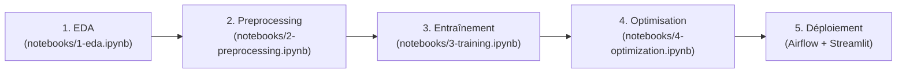

# 🧠 Prédiction du Risque de Santé Mentale chez les Étudiants

---

---

## 📌 1. Contexte du Projet & Objectifs Métier

Projet Data Science réalisé dans le cadre du **Brief Jury Blanc (YouCode)**.  
L'objectif est d'étudier les facteurs associés aux difficultés psychologiques chez les étudiants, de concevoir un pipeline rigoureux de Machine Learning supervisé (classification multi-classes : `Low`, `Medium`, `High`), et de déployer une solution complète comprenant une orchestration automatisée avec **Apache Airflow** et une interface d'aide à la décision interactive avec **Streamlit**.

### 🎯 Objectifs Métier
* **Détection précoce des risques :** Identifier les étudiants présentant un risque accru de détresse psychologique.
* **Prévention ciblée :** Anticiper les besoins d'accompagnement avant l'aggravation des symptômes ou le décrochage académique.
* **Compréhension des facteurs déterminants :** Mettre en évidence les leviers d'action (sommeil, stress financier, soutien familial, équilibre vie-études).
* **Orientation & Accompagnement :** Faciliter la mise en relation bienveillante avec les cellules d'écoute et les services sociaux universitaires.
* **Priorisation des ressources :** Optimiser l'allocation des effectifs d'aide médico-sociale sur le campus.

> ⚠️ **Avertissement éthique et légal (Strictement Pédagogique) :**  
> Ce système constitue un prototype d'aide à l'orientation et à la prévention précoce basé sur des données synthétiques.  
> **Il ne doit en aucun cas être utilisé comme un outil de diagnostic médical, de dépistage clinique, de sélection d'étudiants, d'évaluation académique ou de décision disciplinaire.**

---

## 📊 2. Jeu de Données (Dataset)

* **Source :** [Mental Health Risk Prediction Dataset — Students (Kaggle)](https://www.kaggle.com/datasets/maqdadali/mental-health-risk-prediction-dataset-students)
* **Emplacement local :** `data/raw/student_mental_health.csv`
* **Dimensions :** 2 000 observations, 17 variables (16 caractéristiques explicatives + 1 cible)
* **Partitionnement :** Split strict 80 % entraînement (1 600 lignes) / 20 % test indépendant (400 lignes), stratifié sur la cible.

### Dictionnaire des variables

| Variable | Type | Description | Traitement dans le Pipeline |
|---|---|---|---|
| `Student_ID` | Identifiant | Identifiant unique de l'étudiant | Supprimé (aucune valeur prédictive) |
| `Age` | Numérique | Âge de l'étudiant (18–35 ans) | Médiane + Standardisation |
| `Gender` | Catégoriel | Genre (`Male`, `Female`, `Other`) | One-Hot Encoding |
| `Year_of_Study` | Numérique | Année du cursus universitaire (1 à 5) | Médiane + Standardisation |
| `Sleep_Hours` | Numérique | Heures de sommeil moyen par nuit (h) | Médiane + Capping IQR + Standardisation |
| `Study_Hours_Per_Week` | Numérique | Heures d'étude par semaine (h) | Médiane + Capping IQR + Standardisation |
| `GPA` | Numérique | Moyenne académique (échelle 0.0 à 4.0) | Médiane + Capping IQR + Standardisation |
| `Social_Media_Hours` | Numérique | Temps quotidien sur les réseaux sociaux (h) | Médiane + Capping IQR + Standardisation |
| `Screen_Time_Hours` | Numérique | Temps d'écran quotidien total (h) | Médiane + Capping IQR + Standardisation |
| `Physical_Activity` | Catégoriel Ordinal | Activité physique (`Low`, `Moderate`, `High`) | Encodage Ordinal [0, 1, 2] |
| `Financial_Stress` | Numérique | Niveau de stress financier (score 1 à 10) | Médiane + Standardisation |
| `Family_Support` | Numérique | Niveau de soutien familial perçu (score 1 à 10) | Médiane + Standardisation |
| `Attendance_Rate` | Numérique | Taux d'assiduité aux cours (%) | Médiane + Capping IQR + Standardisation |
| `Part_Time_Job` | Binaire | Exercice d'un emploi étudiant (`Yes`, `No`) | One-Hot Encoding |
| `Diet_Quality` | Catégoriel Ordinal | Qualité perçue du régime alimentaire (`Poor`, `Average`, `Good`) | Encodage Ordinal [0, 1, 2] |
| `Previous_Mental_Health_History` | Binaire | Antécédents de santé mentale personnels (`Yes`, `No`) | One-Hot Encoding |
| **`Mental_Health_Risk`** | **Cible (3 classes)** | **Niveau de risque global (`Low`, `Medium`, `High`)** | Variable cible à prédire |

---

## 🧭 3. Démarche Méthodologique

Le projet suit rigoureusement les 5 étapes demandées par le brief pédagogique :

### Étape 1 — Chargement & Analyse Exploratoire (EDA)
* Audit de conformité : structure des types, absence de doublons d'enregistrement, analyse des valeurs manquantes (~0.5 % sur quelques colonnes).
* Analyse de distribution : répartition équilibrée de la cible multi-classes (~33 % pour chaque classe `Low`, `Medium`, `High`).
* Détection statistique des valeurs aberrantes (*outliers*) via la méthode de l'écart interquartile (IQR).
* Analyse de corrélation et d'association (Pearson, Spearman et ANOVA) : mise en évidence d'une relation monotone forte entre le déficit de sommeil, le stress financier élevé, le manque de soutien familial et l'élévation du risque psychologique.

### Étape 2 — Transformation & Préparation des Données
* **Split étanche :** Séparation immédiate train (80 %) / test (20 %) avec stratification afin de garantir l'absence absolue de fuite d'information (*data leakage*).
* **Imputation robuste :** `SimpleImputer` par la médiane pour les variables continues et par le mode (`most_frequent`) pour les variables catégorielles.
* **Traitement des outliers :** Création d'un transformateur scikit-learn sur mesure (`IQRCapper`) calculant les bornes $[Q_1 - 1.5 \times IQR, Q_3 + 1.5 \times IQR]$ uniquement sur le jeu d'entraînement.
* **Encodage différentié :**
  * `OneHotEncoder(handle_unknown='ignore')` pour les variables nominales (`Gender`, `Part_Time_Job`, `Previous_Mental_Health_History`).
  * `OrdinalEncoder` respectant la sémantique ordonnée (`Physical_Activity`, `Diet_Quality`).
